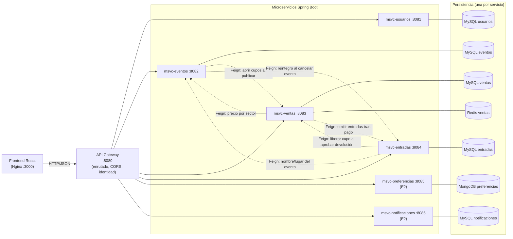

# Arquitectura de microservicios — Entrega 1

Fuente: `specs/arquitectura.md`, `specs/microservicios.md`, `specs/comunicacion.md`, `specs/endpoints.md` y el código.

## 1. Diagrama de módulos

Reglas de la arquitectura:
- El navegador habla **solo con el gateway**; nunca con un microservicio directo.
- **Una base de datos por microservicio.** No se comparten entidades ni tablas; las referencias entre servicios son lógicas (UUID sin FK física). Ver `modelo-datos.md`.
- Comunicación **REST síncrona** (OpenFeign) entre microservicios para el flujo de E1.
- **Broker RabbitMQ** para eventos de dominio (E2): `msvc-eventos` publica `EventoCancelado` en `eventos.exchange` y `msvc-notificaciones` lo consume para generar avisos push. Contrato en `specs/comunicacion.md`.
- Cada servicio es un proyecto Maven independiente con su `Dockerfile` y su `docker-compose.yml`; `Backend/docker-compose.yml` los integra con `include`.

## 2. Responsabilidades

| Servicio | Puerto | Persistencia | Responsabilidad en E1 |
|---|---:|---|---|
| **API Gateway** | 8080 | — | Punto único de entrada, enrutado por prefijo (`/api/...` → servicio), CORS, identificación del usuario y propagación de `X-User-*` |
| **msvc-usuarios** | 8081 | MySQL | Cuentas, login/registro, roles, perfil |
| **msvc-eventos** | 8082 | MySQL | Eventos, lugares, sectores, asientos, participantes, precios, publicación, estados y búsqueda |
| **msvc-ventas** | 8083 | MySQL + Redis | Disponibilidad y cupos, reservas temporales, compras, pagos (mock), emisión de entradas, anti doble venta |
| **msvc-entradas** | 8084 | MySQL | Entradas con QR único, devoluciones, reintegro por cancelación |
| msvc-preferencias | 8085 | MongoDB | *(E2)* preferencias y recomendaciones |
| msvc-notificaciones | 8086 | MySQL | *(E2)* avisos y plantillas |

## 3. APIs públicas por servicio

Todas se consumen vía gateway con prefijo `/api`. Listado completo, parámetros y códigos: `specs/endpoints.md` y `docs/openapi/`.

| Servicio | Rutas principales |
|---|---|
| usuarios | `POST /auth/login`, `POST /auth/register`, `GET/PATCH /usuarios/me`, `GET /usuarios`, `PATCH /usuarios/{id}/estado`, `PUT /usuarios/{id}/roles` |
| eventos | `GET/POST /eventos`, `GET/PUT/DELETE /eventos/{id}`, `POST /eventos/{id}/publicacion`, `PATCH /eventos/{id}/estado`, `PATCH /eventos/{id}/fecha`, `PUT /eventos/{id}/sectores/{sectorId}/precio`, `/eventos/{id}/participantes`, `/lugares/**`, `/sectores/**`, `/participantes/**`, `/organizadores/me/eventos` |
| ventas | `GET /eventos/{id}/disponibilidad`, `GET /eventos/disponibilidad?ids=`, `POST /reservas`, `/reservas/{id}/{confirmacion\|renovacion\|cancelacion}`, `POST /compras`, `POST /compras/{id}/pagos`, `POST /pagos/{id}/reintentos` |
| entradas | `GET /entradas`, `GET /entradas/{id}`, `GET /entradas/{id}/qr`, `POST /entradas/{id}/devoluciones`, `GET /devoluciones`, `POST /devoluciones/{id}/{aprobacion\|rechazo}` |

Solapes de `/eventos/**`: el gateway enruta `/eventos/{id}/disponibilidad` y `/eventos/{id}/cupos` a **ventas** antes del catch-all hacia **eventos**.

## 4. Comunicación entre servicios

| Origen → Destino | Cuándo | Para qué |
|---|---|---|
| eventos → ventas | Al publicar un evento | `POST /eventos/{id}/cupos`: abre el stock por sector (idempotente; si falla, no se publica) |
| ventas → eventos | Al crear una reserva | `GET /eventos/{id}`: obtener el precio unitario del sector |
| entradas → eventos | Al listar/consultar entradas | `GET /eventos/{id}`: enriquecer la entrada con nombre, lugar y estado del evento (best-effort: si falla, esos campos quedan `null`) |
| ventas → entradas | Tras un pago aprobado | `POST /entradas/emision`: crear entradas con QR (idempotente por compra, con reintentos y job) |
| entradas → ventas | Al aprobar una devolución | `POST /eventos/{id}/cupos/liberacion`: devolver 1 lugar al cupo |
| eventos → entradas | Al cancelar un evento | `POST /eventos/{id}/reintegro-cancelacion` (best-effort) |

Headers relevantes: `X-User-Id`, `X-User-Role` (identidad), `Idempotency-Key` (reservas y compras).

## 5. Identificación del usuario (E1)

Según la consigna, en la Entrega 1 no hay autenticación formal: la identidad llega por encabezado (`X-User-Id`, `X-User-Role`) y los microservicios confían en ella. El gateway admite también JWT con roles, activable con `TICKETYA_JWT_ENABLED=true` (adelanto de la Entrega 2). Detalle en el `README.md` raíz.

## 6. Despliegue

`cd Backend && docker compose up -d --build` levanta gateway, microservicios, bases y frontend (15 contenedores). Puertos y diagrama Docker: `specs/infraestructura.md`.
