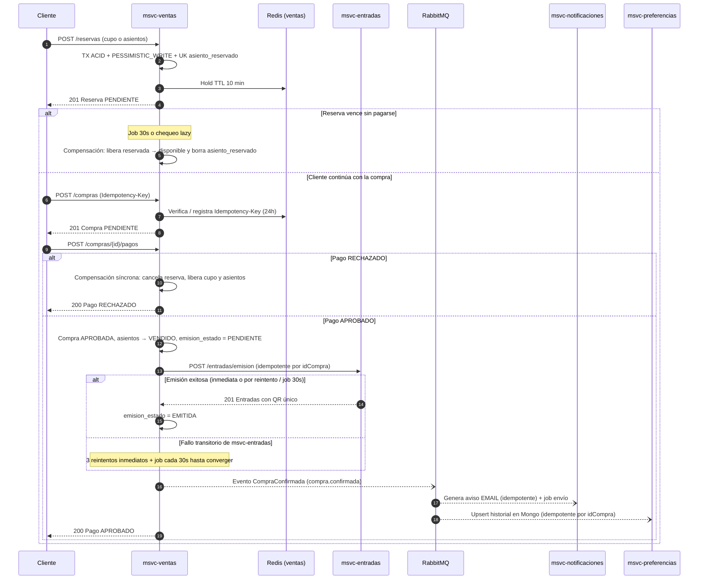

# Estrategias de consistencia entre servicios y compensaciones (ARQ-05)

**Entregable 2 — Consigna §6.B**  
Documenta cómo TicketYa garantiza la consistencia de datos en una arquitectura con **una base de datos por microservicio** (sin transacciones distribuidas 2PC/XA), qué operaciones requieren consistencia fuerte local, cuáles convergen de forma eventual y qué compensaciones o mecanismos de recuperación se aplican ante fallos parciales.

---

## 1. Principios de diseño

1. **Consistencia fuerte dentro de cada microservicio (ACID local):** toda invariante crítica de negocio (no doble venta de cupos/asientos, no reutilización de un QR en puerta, unicidad de idempotencia) se resuelve dentro de un único servicio mediante transacciones relacionales, bloqueos pesimistas (`SELECT ... FOR UPDATE` / `PESSIMISTIC_WRITE`) y restricciones `UNIQUE` en base de datos.
2. **Sin transacciones distribuidas entre servicios:** las operaciones que cruzan microservicios utilizan llamadas REST síncronas con política explícita (*fail-hard*, *reintentos + job* o *best-effort*) o eventos asíncronos sobre RabbitMQ (`eventos.exchange`), siempre combinados con **idempotencia** en el receptor.
3. **Compensación explícita ante fallos parciales:** cuando un paso intermedio falla (pago rechazado, reserva vencida, devolución aprobada o cancelación de evento), se ejecuta una acción compensatoria que devuelve el sistema a un estado comercialmente consistente.

---

## 2. Matriz de consistencia y compensaciones por flujo

| Flujo | Servicios involucrados | Modelo de consistencia | Mecanismo de protección | Fallo parcial / escenario de error | Compensación o recuperación |
|---|---|---|---|---|---|
| **Publicación de evento** | `eventos` → `ventas` (`POST /eventos/{id}/cupos`) | **Síncrono fail-hard** | Endpoint idempotente por `(id_evento, id_sector)` | `ventas` no responde o rechaza la apertura de cupos | El evento **no** cambia a `PUBLICADO` (se aborta la transición en `eventos`). Al reintentar publicar, la apertura es idempotente. |
| **Reserva temporal (general o numerada)** | `ventas` (MySQL + Redis) | **Fuerte (local ACID)** | `PESSIMISTIC_WRITE` sobre `cupo_sector` + `UNIQUE(id_evento, id_sector, fila, numero)` en `asiento_reservado` + hold auxiliar en Redis (TTL 10 min) | Dos clientes reservan el último cupo o el mismo asiento a la vez; o el cliente abandona antes de pagar | El segundo pedido falla con `409 Conflict` sin alterar contadores. Si la reserva vence, la expiración *lazy* + el job cada 30 s liberan `cantidad_reservada → cantidad_disponible` y borran `asiento_reservado`. |
| **Compra desde reserva** | `ventas` (MySQL + Redis) | **Fuerte (local ACID)** | Header `Idempotency-Key` obligatorio (almacenado en Redis 24 h) + validación de límite de 6 entradas por cliente/evento | Reintento de red del cliente tras timeout | Se devuelve la compra ya creada para esa `Idempotency-Key` sin duplicar compra ni descontar cupo dos veces. |
| **Pago de compra** | `ventas` (pasarela mock) | **Fuerte (local ACID)** | Transacción sobre `compra`, `pago`, `reserva`, `cupo_sector` y `asiento_reservado` | Pago rechazado por la pasarela | **Compensación síncrona:** la compra queda `RECHAZADA`, la reserva pasa a `CANCELADA`, se libera `cantidad_reservada → cantidad_disponible` y se eliminan los `asiento_reservado`. |
| **Emisión de entradas tras pago aprobado** | `ventas` → `entradas` (`POST /entradas/emision`) | **Eventual con reintentos garantizados (Saga)** | Estado persistido `compra.emision_estado` (`PENDIENTE` → `EMITIDA` / `FALLIDA`) + idempotencia por `idCompra` en `entradas` | `entradas` está caído o da timeout justo después de aprobar el pago | **No se revierte el pago.** `EmisionEntradasService` ejecuta 3 reintentos inmediatos y, si persiste el fallo, un job `@Scheduled` cada 30 s reintenta las compras pendientes hasta emitirlas. Si `entradas` ya las emitió en un intento previo, responde de forma idempotente sin duplicar QRs. |
| **Aprobación de devolución** | `entradas` → `ventas` (`POST /eventos/{id}/cupos/liberacion`) + RabbitMQ | **Síncrono fail-hard (cupo) + Eventual (notificación)** | Liberación de cupo/asiento antes de confirmar estado; invalidación del QR (`INV-*`) | `ventas` no responde al liberar el cupo | La devolución **no** pasa a `APROBADA` (se revierte la transacción en `entradas`). Una vez aprobada, se publica `devolucion.aprobada` a RabbitMQ para notificar al cliente de forma eventual. |
| **Cancelación de evento** | `eventos` → `entradas` (`POST /eventos/{id}/reintegro-cancelacion`) + RabbitMQ | **Eventual (best-effort en reintegro + async en avisos)** | Estado `CANCELADO` en `eventos`; paso masivo de entradas a `A_REINTEGRAR` (sin devolver cupo a `ventas`) | `entradas` no responde en el momento de cancelar | El evento queda `CANCELADO` (evita nuevas compras). El endpoint de reintegro es idempotente y puede reejecutarse; además `entradas` verifica el estado del evento al validar QR (`409 EVENTO_CANCELADO`). |
| **Control de acceso QR** | `entradas` → `eventos` (`GET /eventos/{id}`) | **Fuerte (local ACID)** | `SELECT ... FOR UPDATE` sobre `entrada` por código QR + auditoría en `validacion_acceso` | Varias puertas escanean el mismo QR simultáneamente | Solo una transacción transiciona `VENDIDA → USADA` (`200 VALIDA`); las restantes leen `USADA` y responden `409 YA_USADA`. |
| **Historial, recomendaciones y notificaciones** | `ventas`/`eventos`/`entradas` → RabbitMQ → `preferencias` y `notificaciones` | **Eventual (Pub/Sub)** | Colas durables; upsert idempotente por `idCompra` en MongoDB; idempotencia por `messageId` + `clave_mensaje` en MySQL notificaciones; `SKIP LOCKED` + 3 intentos en `intento_envio` | Consumidor caído o proveedor SMTP lento/caído | RabbitMQ retiene los mensajes hasta que el consumidor vuelve. En `notificaciones`, el job reintenta envíos hasta 3 veces registrando cada intento. En `preferencias`, `POST /internas/backfill` permite reconstruir historial faltante desde `ventas`. |

---

## 3. Diagrama de la saga de compra, emisión y compensaciones

---

## 4. Compensación en devoluciones y cancelación de eventos

- **Devolución individual aprobada (`ADMIN`):**
  1. `msvc-entradas` llama primero de forma síncrona a `msvc-ventas` (`POST /eventos/{id}/cupos/liberacion`) indicando sector y, si corresponde, asiento `(fila, numero)`.
  2. Si `msvc-ventas` falla, la aprobación aborta y la devolución sigue `PENDIENTE` (no se pierde stock ni queda entrada devuelta sin liberar lugar).
  3. Si `msvc-ventas` libera correctamente, `msvc-entradas` marca la devolución `APROBADA`, pasa la entrada a `DEVUELTA`, invalida su QR (`INV-*`) y publica `devolucion.aprobada` en RabbitMQ.
- **Cancelación de evento (`ADMIN`):**
  1. `msvc-eventos` cambia el evento a `CANCELADO`.
  2. Invoca `POST /eventos/{id}/reintegro-cancelacion` en `msvc-entradas` (las entradas `VENDIDA` pasan a `A_REINTEGRAR` con trámite `EN_CURSO` y QR invalidado; no se devuelve cupo a `msvc-ventas` porque el evento no vuelve a venderse).
  3. Publica `evento.cancelado` en RabbitMQ para que `msvc-notificaciones` avise por `PUSH + EMAIL` a todos los compradores aprobados.

---

## 5. Limitaciones conocidas y mejoras futuras

- **Patrón Outbox en publicación a RabbitMQ:** hoy los eventos de dominio se publican tras el commit de base de datos; ante una caída simultánea del proceso entre el commit local y el publish al broker podría perderse un aviso. Para historial esto se mitiga con el endpoint idempotente `POST /internas/backfill`; en un entorno productivo se incorporaría una tabla *Transactional Outbox*.
- **Cancelación de evento *best-effort* hacia `msvc-entradas`:** si `msvc-entradas` estuviera caído durante la cancelación, el evento queda igualmente `CANCELADO` (bloqueando ventas y accesos) y el reintegro masivo puede reejecutarse de forma segura porque el endpoint es idempotente.
- **Reintegro económico en pasarela:** al ser una pasarela simulada (mock), el reintegro se registra como estado de negocio (`APROBADA` / `A_REINTEGRAR`) sin interacción con un procesador bancario externo.
