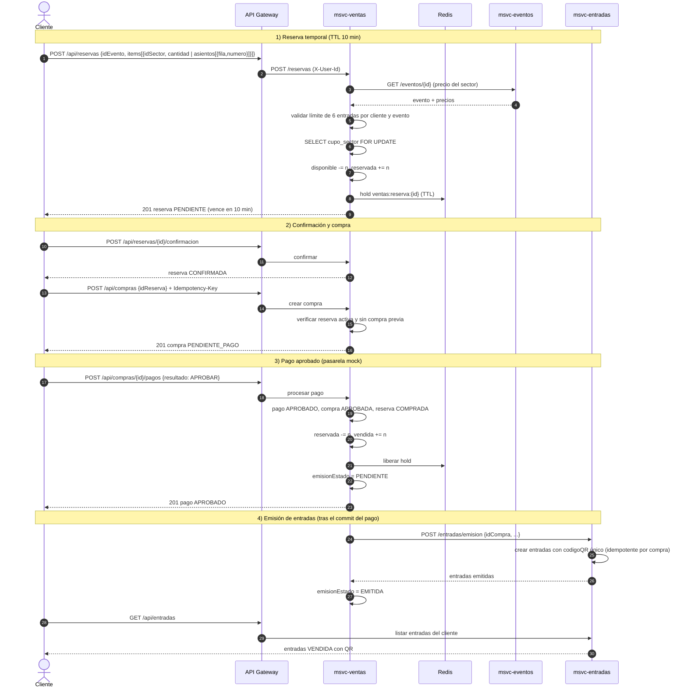
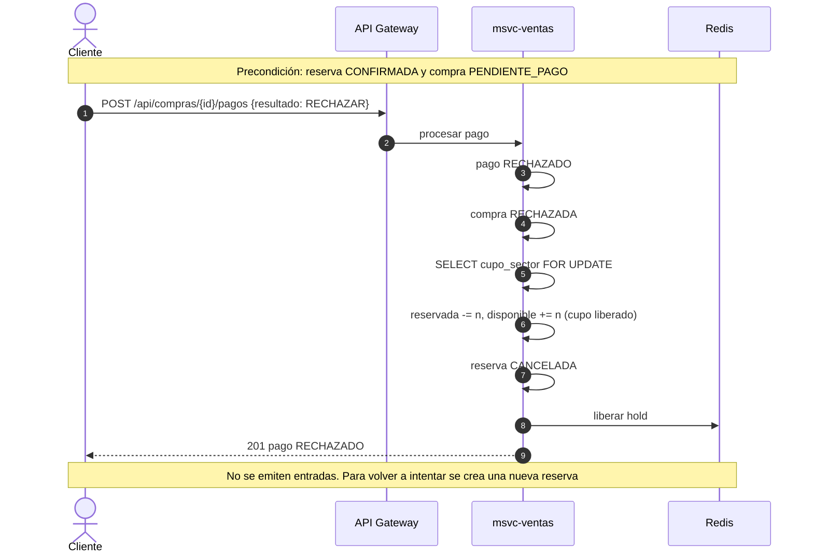
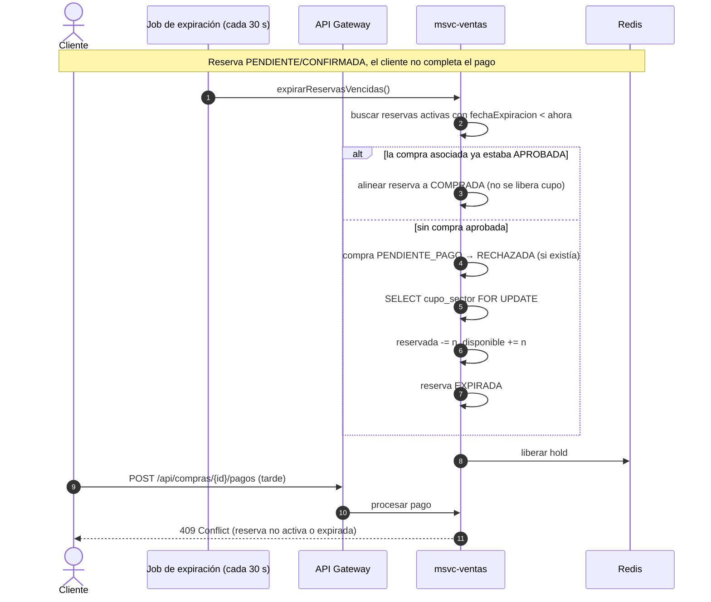
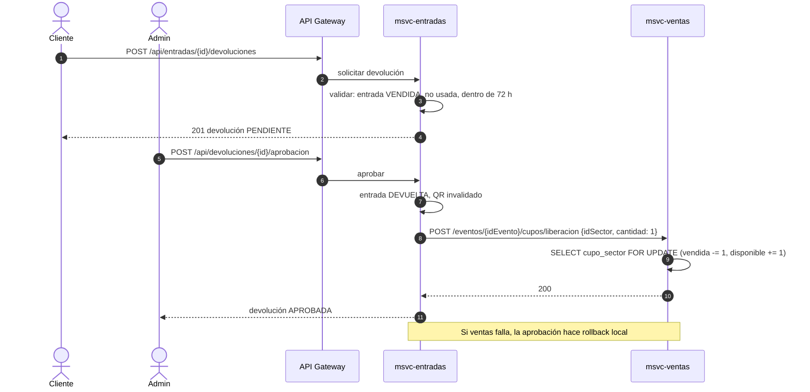
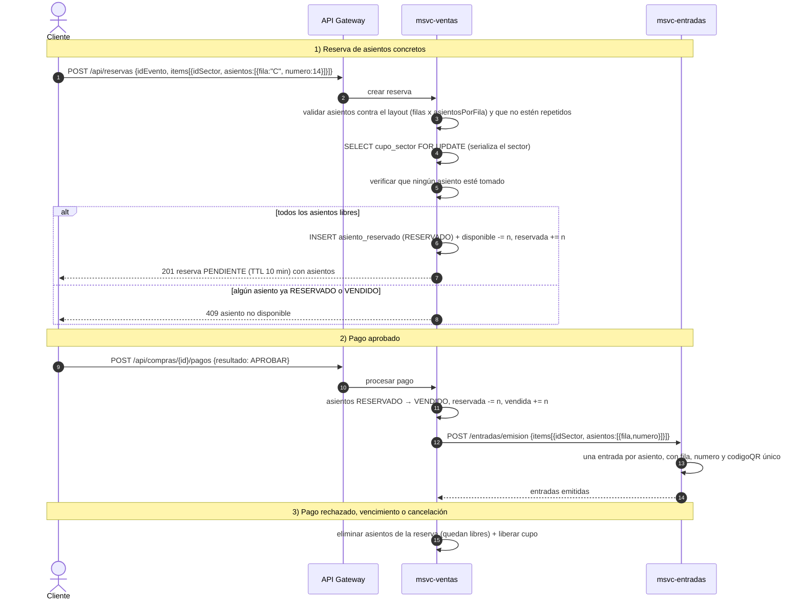

# Diagramas de secuencia — Compra de entradas

Fuente: `msvc-ventas` (`VentaServiceImpl`, `EmisionEntradasService`, `ReservaExpirationJob`) y `specs/reglas-de-negocio.md` §5–§6.
Las rutas son las públicas del gateway (`/api/...`).

## Estados que intervienen

| Entidad | Estados |
|---|---|
| Reserva | `PENDIENTE` → `CONFIRMADA` → `COMPRADA` \| `CANCELADA` \| `EXPIRADA` |
| Compra | `PENDIENTE_PAGO` → `APROBADA` \| `RECHAZADA` |
| Pago | `APROBADO` \| `RECHAZADO` |
| Emisión de QR (`compra.emisionEstado`) | `NO_REQUIERE` → `PENDIENTE` → `EMITIDA` \| `FALLIDA` |
| Cupo por sector | `disponible` ⇄ `reservada` → `vendida` |
| Asiento de sector numerado (`asiento_reservado`) | `RESERVADO` → `VENDIDO` (o se elimina al liberarse) |

## 1. Compra exitosa (reserva → compra → pago aprobado → entradas con QR)

Si el paso 4 falla (entradas no responde): se reintenta hasta 3 veces de inmediato; si sigue fallando, la compra queda `emisionEstado=PENDIENTE` y un job la reprocesa cada 30 s (máx. 20 intentos, luego `FALLIDA`). La emisión es idempotente: reintentar no duplica entradas. El pago y el cupo vendido **no** se revierten.

## 2. Pago rechazado

Limitación conocida: `POST /pagos/{id}/reintentos` solo reabre un pago rechazado si la reserva sigue activa; como el rechazo libera el cupo y cancela la reserva, tras un rechazo hay que crear una reserva nueva (la colección Postman lo documenta como `409`).

## 3. Vencimiento de la reserva

La expiración también ocurre de forma *lazy*: al consultar `GET /reservas/{id}` con el TTL vencido, la reserva se expira en el momento. Renovar (`POST /reservas/{id}/renovacion`) extiende el vencimiento en MySQL y en Redis.

## 4. Devolución (complementa el circuito)

## 5. Entrada numerada (asiento concreto)

Los sectores pueden ser **generales** (se reserva por cantidad) o **numerados** (se reservan asientos concretos: fila + número). En un sector numerado el layout se define con `filas` × `asientosPorFila` y la capacidad es el producto; los asientos son **virtuales** (se calculan, no se guardan los libres). En `msvc-ventas` solo se persisten los asientos **tomados**, en `asiento_reservado` (estado `RESERVADO` o `VENDIDO`), con clave única `(id_evento, id_sector, fila, numero)`.

Reglas y errores:
- Sector numerado sin asientos, asiento inexistente en el layout o repetido en el pedido → `400`.
- Sector general con asientos → `400`.
- Asiento ya tomado (`RESERVADO`/`VENDIDO`) → `409`.
- Pago rechazado, reserva vencida o cancelada: los asientos se eliminan de `asiento_reservado` y vuelven a estar libres, igual que el cupo.
- **Devolución aprobada:** `POST /eventos/{id}/cupos/liberacion` con `{idSector, asientos:[{fila,numero}]}` (deben figurar `VENDIDO`) libera esos asientos y devuelve el cupo.
- `GET /eventos/{id}/disponibilidad` informa por sector `asientosOcupados[{fila,numero,estado}]` para que el frontend marque los no disponibles.

## Garantía de no doble venta

Hay dos defensas combinadas:
1. **Bloqueo pesimista** (`SELECT … FOR UPDATE`) sobre `cupo_sector`: serializa las reservas concurrentes de un mismo sector. Si N clientes piden el último lugar (o el mismo asiento) a la vez, uno obtiene la reserva y los demás reciben `409`.
2. **Clave única** `(id_evento, id_sector, fila, numero)` en `asiento_reservado`: segunda defensa a nivel de base para el mismo asiento.

Evidencia: `docs/testing/concurrencia.md` (último cupo y mismo asiento, con MySQL real) y `ReservaAsientoConcurrenciaTest` (20 hilos compiten por el mismo asiento; un solo éxito).
