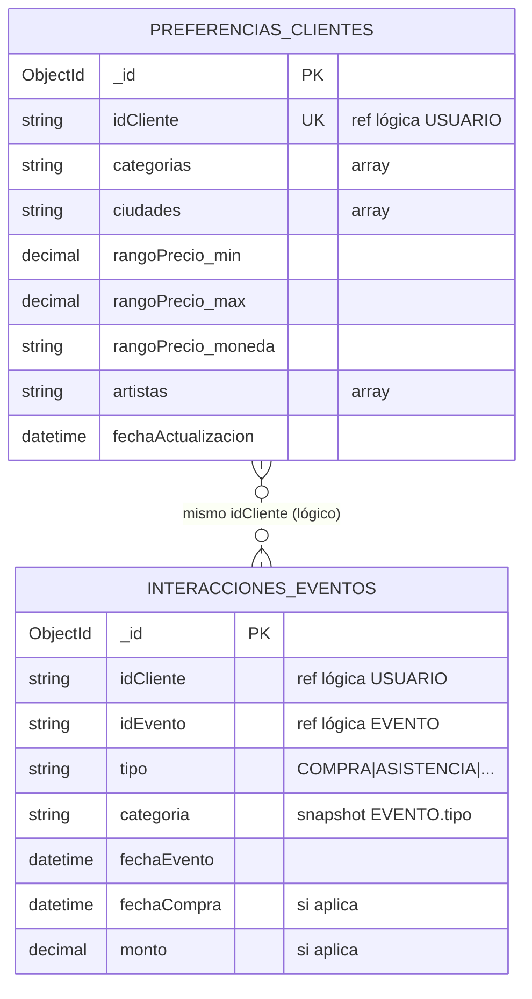

## Modelo de datos – msvc-preferencias-recomendaciones (MongoDB)

Se utilizará MongoDB con un modelo documental compuesto por dos colecciones.
No hay claves foráneas físicas: `idCliente` e `idEvento` son **referencias lógicas** a MySQL (`USUARIO.idUsuario`, `EVENTO.id`) en otros microservicios.

### 1. `preferencias_clientes`
Almacena las preferencias de cada cliente en un único documento.

- `idCliente`: identificador del cliente.
- `categorias[]`: categorías de eventos preferidas.
- `ciudades[]`: ubicaciones de interés.
- `rangoPrecio`: objeto embebido con mínimo, máximo y moneda.
- `artistas[]`: artistas de interés.
- `fechaActualizacion`: última modificación.

### 2. `interacciones_eventos`
Almacena el historial de interacciones de los clientes con eventos, mediante un documento por interacción.

- `idCliente`: identificador del cliente.
- `idEvento`: identificador del evento.
- `tipo`: tipo de interacción (COMPRA, ASISTENCIA, etc.).
- `categoria`: categoría del evento.
- `fechaEvento`: fecha del evento.
- `fechaCompra`: fecha de compra, cuando corresponda.
- `monto`: importe de la operación, cuando corresponda.

### Criterios de diseño
- Se utiliza un documento por cliente para sus preferencias.
- El historial se almacena en documentos independientes para permitir un crecimiento sin arrays ilimitados.
- `idCliente` e `idEvento` funcionan como referencias a otros microservicios, sin claves foráneas.
- Se definirán índices sobre `idCliente` e `idEvento` para optimizar las consultas.
- Las operaciones de consulta y actualización se implementarán mediante Spring Data MongoDB.
