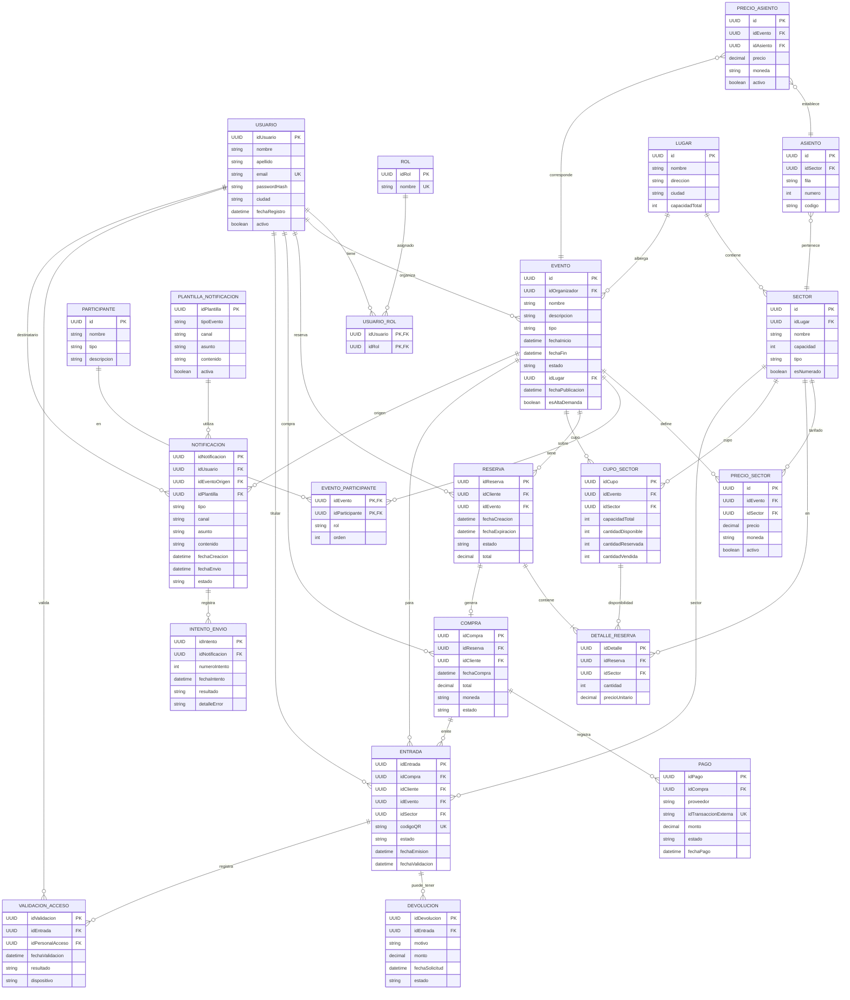

# Modelo de datos

Modelo **relacional** (MySQL) de los microservicios transaccionales.
Preferencias / historial de señales → MongoDB: ver [`modelo-mongodb.md`](./modelo-mongodb.md).

En cada entidad, los atributos marcados **FK** son claves foráneas (lógicas o físicas según el msvc dueño).

