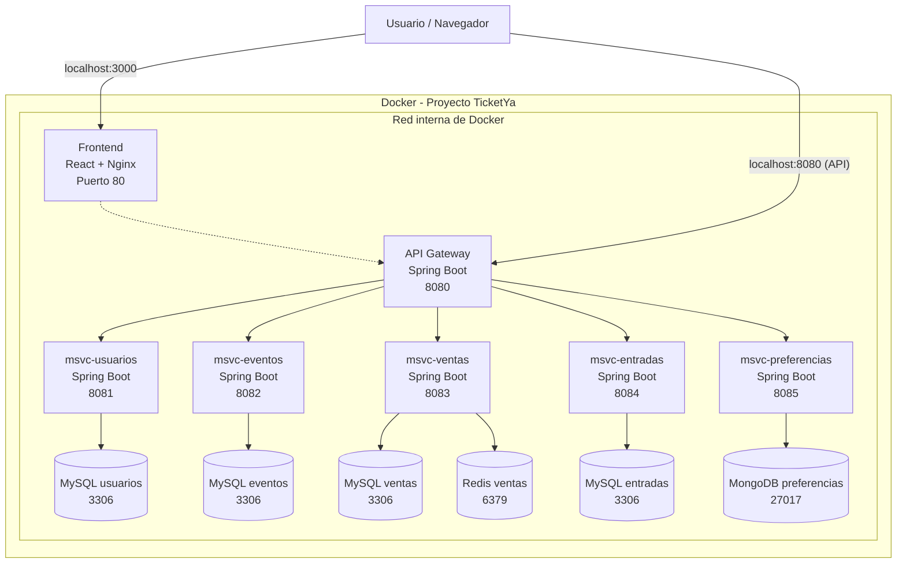

# Estrategia Docker – TicketYa

Se utilizará una arquitectura Docker modular que permita desarrollar y ejecutar cada microservicio de manera independiente,
pero también levantar el sistema completo para realizar pruebas de integración.

### 1. Dockerfile
- Cada microservicio tendrá su propio `Dockerfile`.
- Define cómo construir la imagen Docker de la aplicación.
- Establece la imagen base, dependencias, puertos y comando de ejecución.

### 2. Docker Compose individual
- Cada microservicio tendrá su propio `docker-compose.yml`.
- Definirá su contenedor de aplicación y las dependencias necesarias (base de datos y servicios auxiliares).
- Permitirá desarrollar y probar cada servicio sin levantar los demás.

### 3. Docker Compose general
- Se ubica en `Backend/docker-compose.yml` (también referenciado desde `infrastructure/`).
- Utiliza `include` para incorporar los Compose individuales (`APIGateway` y cada `msvc-*`).
- Permite levantar todos los microservicios, sus bases de datos y el API Gateway mediante un único comando.

### 4. Distribución de servicios

| Microservicio | Infraestructura             |
|---|-----------------------------|
| Usuarios | Spring Boot + MySQL         |
| Eventos | Spring Boot + MySQL         |
| Ventas | Spring Boot + MySQL + Redis |
| Entradas | Spring Boot + MySQL         |
| Preferencias | Spring Boot + MongoDB       |
| API Gateway | Spring Boot                 |

Cada microservicio tendrá su propia base de datos lógica y será responsable exclusivo de administrar sus datos, una base por microservicio.

### 5. Comandos principales

**Desarrollo individual:**
```bash
cd Backend/msvc-ventas
docker compose up -d
```

**Integración completa (desde Backend/):**
```bash
cd Backend
docker compose up -d
```

**Detener contenedores:**
```bash
docker compose down
```


### 6. Consideraciones
- Los contenedores de cada microservicio tendrán nombres y puertos diferenciados para evitar conflictos.
- Se utilizarán volúmenes para persistir los datos de las bases.
- Las credenciales se administrarán mediante variables de entorno (`.env`), sin subir secretos al repositorio.
- localhost se utiliza para acceder desde el host (la computadora), pero entre contenedores Docker se utilizan los nombres de servicio y sus puertos internos.
- La configuración general deberá mantener compatibilidad con los Compose individuales.

### 7. Decisiones
- Cada microservicio y el API Gateway tienen su propio Dockerfile.
- Cada microservicio tiene su propio docker-compose.yml, que levanta su aplicación y su base de datos (el Gateway solo la app).
- El Compose general en Backend/ permite levantar todo el sistema con `include`.
- Utilizamos MySQL 8.4, MongoDB y Redis.
- Los puertos se publican en localhost y coinciden con `EXPOSE` del Dockerfile y `server.port` del `application.yml`.
- Cada microservicio tiene su propia instancia de base de datos, no comparte contenedores MySQL con otros servicios.


de esta amnera se garantiza autonomía de desarrollo para cada integrante y facilita la integración y ejecución conjunta de TicketYa.


## Distribución de puertos

Se asignan puertos locales diferenciados para evitar conflictos cuando se ejecuten varios microservicios simultáneamente.

| Servicio | Puerto local (host) | Puerto interno (contenedor) |
|---|---:|---:|
| API Gateway | 8080 | 8080 |
| msvc-usuarios | 8081 | 8081 |
| msvc-eventos | 8082 | 8082 |
| msvc-ventas | 8083 | 8083 |
| msvc-entradas | 8084 | 8084 |
| msvc-preferencias | 8085 | 8085 |
| MySQL usuarios | 3307 | 3306 |
| MySQL eventos | 3308 | 3306 |
| MySQL ventas | 3309 | 3306 |
| MySQL entradas | 3310 | 3306 |
| MongoDB preferencias | 27018 | 27017 |
| Redis ventas | 6380 | 6379 |

### Consideraciones

- **Puerto local (host):** permite acceder al servicio desde la computadora mediante `localhost`.
- **Puerto interno (contenedor):** es el puerto en el que escucha el servicio dentro de Docker.
- La sintaxis de publicación de puertos es `PUERTO_HOST:PUERTO_CONTENEDOR`.
- Los microservicios se comunican internamente utilizando los nombres de servicio Docker y sus puertos internos.
- Cada instancia MySQL utiliza internamente el puerto `3306`, pero se publica en un puerto local diferente.
- Los puertos de Spring Boot deben coincidir con los definidos en sus respectivos `application.yml`.
- Cada microservicio tiene su propia base de datos, con sus propias tablas y relaciones.

### Ejemplos de acceso

| Recurso | Dirección |
|---|---|
| API Gateway | `http://localhost:8080` |
| Usuarios | `http://localhost:8081` |
| Eventos | `http://localhost:8082` |
| Ventas | `http://localhost:8083` |
| Entradas | `http://localhost:8084` |
| Preferencias | `http://localhost:8085` |
| MySQL usuarios | `localhost:3307` |
| MySQL eventos | `localhost:3308` |
| MySQL ventas | `localhost:3309` |
| MySQL entradas | `localhost:3310` |
| MongoDB | `localhost:27018` |
| Redis | `localhost:6380` |

**Nota:** esta distribución corresponde al entorno de desarrollo local. Los puertos publicados deben estar disponibles en el equipo para evitar conflictos con otros procesos o contenedores.





