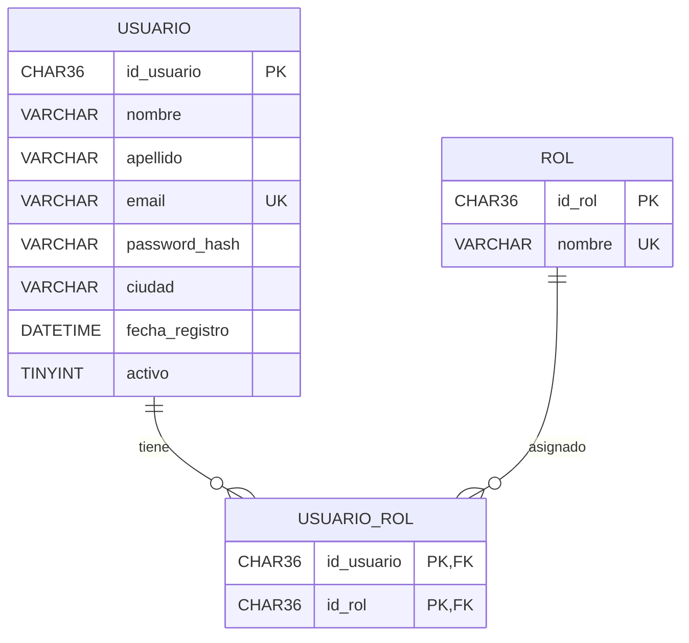
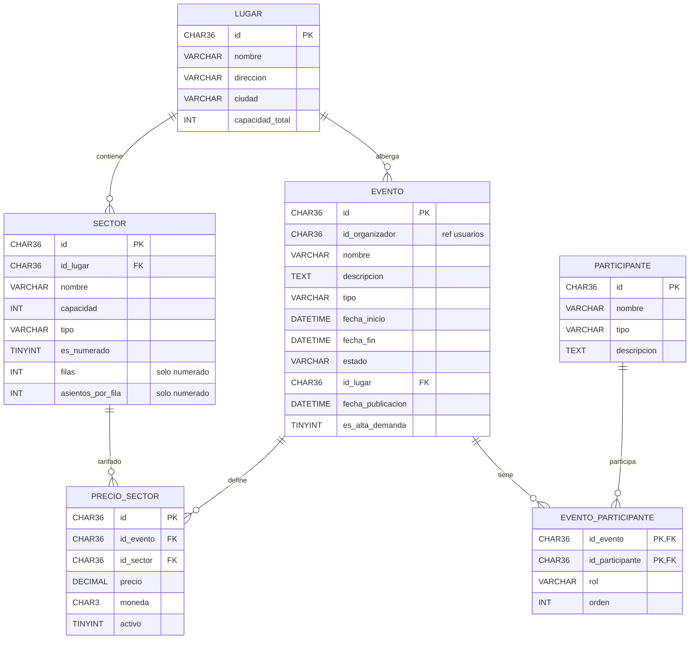
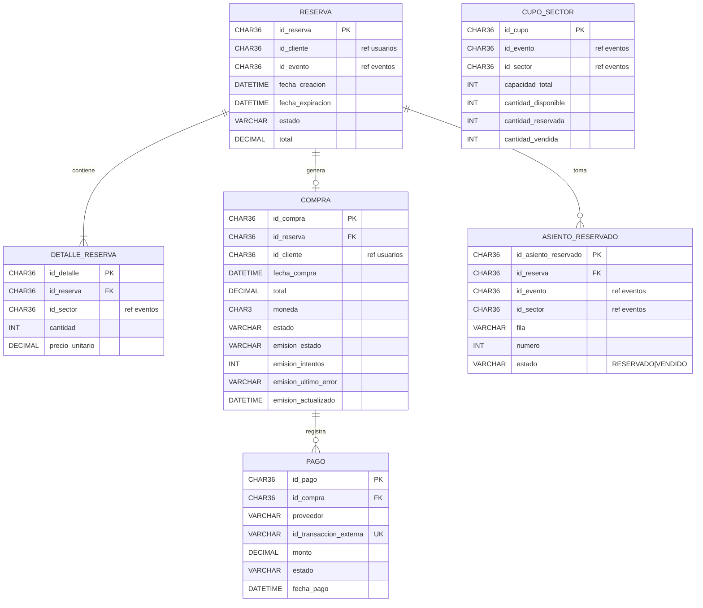
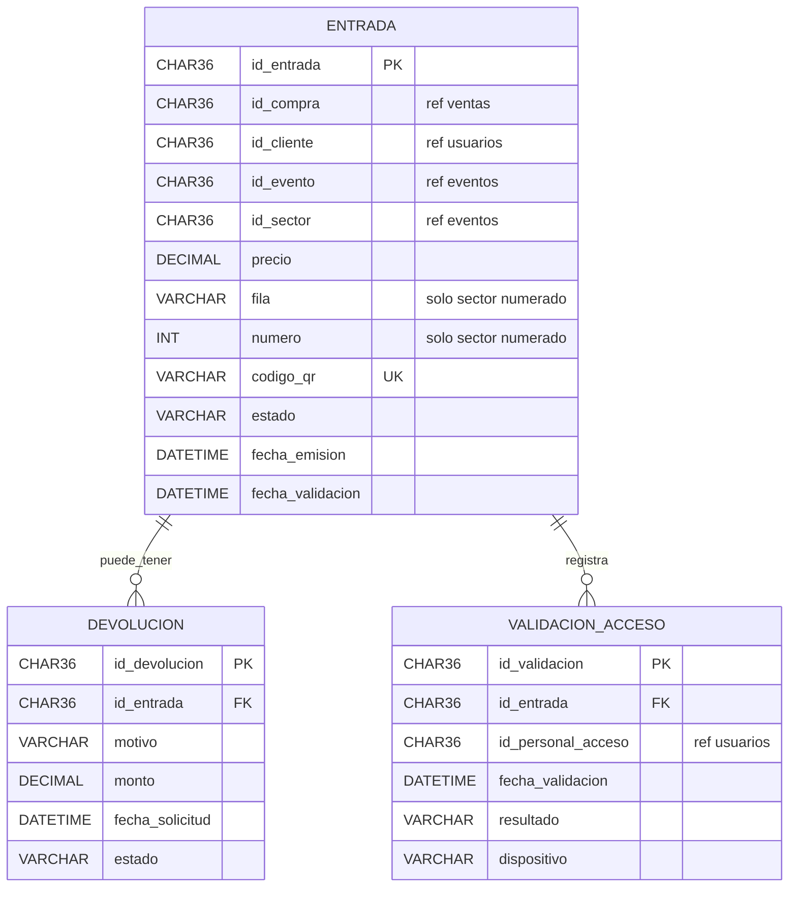
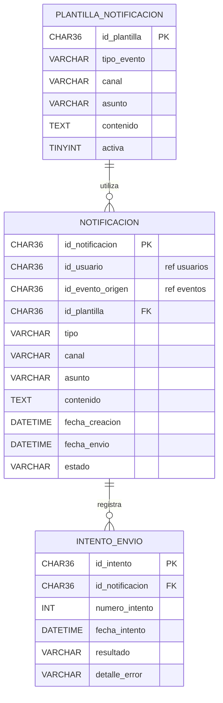

# Modelo de datos — Entrega 1

Fuente: `Backend/infrastructure/mysql/*/init.sql` (esquema real) y `specs/diagramas/modelo.md` (ER global de trabajo).
**Una base de datos relacional por microservicio.** No hay FK físicas entre bases: las referencias entre servicios son **lógicas** (columna `CHAR(36)` con el UUID del recurso del otro servicio).

Leyenda: `PK` clave primaria · `FK` clave foránea física (misma base) · `UK` clave única · `ref` referencia lógica a otro servicio.

## Índice

1. [msvc-usuarios](#1-msvc-usuarios-mysql-usuarios)
2. [msvc-eventos](#2-msvc-eventos-mysql-eventos)
3. [msvc-ventas](#3-msvc-ventas-mysql-ventas)
4. [msvc-entradas](#4-msvc-entradas-mysql-entradas)
5. [msvc-notificaciones](#5-msvc-notificaciones-mysql-notificaciones-e2)
6. [Relaciones entre servicios](#6-relaciones-entre-servicios-referencias-lógicas)
7. [Entidades solapadas](#7-entidades-solapadas-entre-bases)
8. [Preferencias (MongoDB)](#8-preferencias-mongodb-e2)

---

## 1. msvc-usuarios (MySQL `usuarios`)

Roles: `CLIENTE`, `ORGANIZADOR`, `ADMIN`, `PERSONAL_ACCESO`. Un usuario puede tener más de un rol.

## 2. msvc-eventos (MySQL `eventos`)

Único: `(id_evento, id_sector)` en `precio_sector`.

**Asientos virtuales:** un sector numerado guarda `filas` y `asientos_por_fila` (capacidad = filas × asientos por fila); los asientos se calculan y no se persisten. Las tablas `asiento` y `precio_asiento` se eliminaron (SEAT-07): el precio se define solo por sector (`precio_sector`). Estados del evento: `BORRADOR`, `PUBLICADO`, `AGOTADO`, `SUSPENDIDO`, `CANCELADO`, `FINALIZADO`.

## 3. msvc-ventas (MySQL `ventas`; Redis para holds e idempotencia)

`CUPO_SECTOR` tiene clave única `(id_evento, id_sector)` y es la fila sobre la que se aplica `SELECT … FOR UPDATE` (anti doble venta). `ASIENTO_RESERVADO` guarda solo los asientos **tomados** de sectores numerados, con clave única `(id_evento, id_sector, fila, numero)` como segunda defensa contra el doble venta del mismo asiento. No tiene FK física a `DETALLE_RESERVA`: se relacionan por `(id_evento, id_sector)`.

## 4. msvc-entradas (MySQL `entradas`)

`VALIDACION_ACCESO` existe en el esquema pero se usa recién en la Entrega 2. Estados de entrada: `VENDIDA`, `USADA`, `DEVUELTA`, `A_REINTEGRAR`.

## 5. msvc-notificaciones (MySQL `notificaciones`, E2)

## 6. Relaciones entre servicios (referencias lógicas)

No existen FK entre bases. El servicio que consume el dato conoce el UUID y consulta al dueño por API cuando lo necesita.

| Columna (servicio) | Referencia a | Dueño del dato |
|---|---|---|
| `evento.id_organizador` (eventos) | `usuario.id_usuario` | usuarios |
| `reserva.id_cliente`, `compra.id_cliente` (ventas) | `usuario.id_usuario` | usuarios |
| `entrada.id_cliente` (entradas) | `usuario.id_usuario` | usuarios |
| `validacion_acceso.id_personal_acceso` (entradas) | `usuario.id_usuario` | usuarios |
| `notificacion.id_usuario` (notificaciones) | `usuario.id_usuario` | usuarios |
| `reserva.id_evento`, `cupo_sector.id_evento` (ventas) | `evento.id` | eventos |
| `detalle_reserva.id_sector`, `cupo_sector.id_sector` (ventas) | `sector.id` | eventos |
| `entrada.id_evento`, `entrada.id_sector` (entradas) | `evento.id`, `sector.id` | eventos |
| `notificacion.id_evento_origen` (notificaciones) | `evento.id` | eventos |
| `entrada.id_compra` (entradas) | `compra.id_compra` | ventas |

## 7. Entidades solapadas entre bases

La consigna pide identificar entidades que aparecen en más de una base. En TicketYa son **referencias por identificador y copias puntuales de datos**, nunca tablas duplicadas:

| Concepto | Dónde vive la fuente de verdad | Dónde aparece más | Tratamiento |
|---|---|---|---|
| **Usuario / cliente** | usuarios | ventas, entradas, eventos (organizador), notificaciones | Solo el UUID. El nombre o email no se copian |
| **Evento** | eventos | ventas (`reserva`, `cupo_sector`), entradas, notificaciones | Solo el UUID. Datos de presentación (nombre, lugar) se obtienen por Feign (entradas → eventos, best-effort) |
| **Sector** | eventos | ventas (`detalle_reserva`, `cupo_sector`), entradas | UUID. La **capacidad** se copia a `cupo_sector.capacidad_total` al publicar el evento |
| **Precio** | eventos (`precio_sector`) | ventas (`detalle_reserva.precio_unitario`), entradas (`entrada.precio`) | Copia **congelada** al reservar y al emitir: un cambio posterior de precio no altera lo ya vendido |
| **Compra** | ventas | entradas (`entrada.id_compra`) | Solo el UUID; sirve de clave de idempotencia en la emisión |
| **Cupo / stock** | ventas (`cupo_sector`) | eventos (`sector.capacidad`) | Eventos define la capacidad; ventas mantiene el stock vivo (disponible, reservada, vendida) |
| **Asiento** | layout en eventos (`filas`, `asientos_por_fila`); ocupación en ventas (`asiento_reservado`) | entradas (`entrada.fila`, `entrada.numero`) | Eventos define la grilla; ventas registra los tomados; entradas guarda fila/número de cada entrada emitida |

Consistencia entre bases: se resuelve con llamadas REST síncronas, idempotencia (`Idempotency-Key`, emisión por compra) y reintentos; no hay transacciones distribuidas.

## 8. Preferencias (MongoDB, E2)

`msvc-preferencias` usa MongoDB (`preferencias_clientes`, `interacciones_eventos`). Esquema y diagrama: `Backend/specs/diagramas/modelo-mongodb.md`. Referencia lógica a usuarios y eventos por UUID, igual que el resto.
