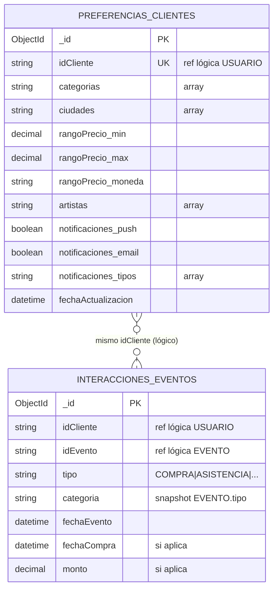

## Modelo de datos – msvc-preferencias-recomendaciones (MongoDB)

Se utilizará MongoDB con un modelo documental compuesto por dos colecciones.
No hay claves foráneas físicas: `idCliente` e `idEvento` son **referencias lógicas** a MySQL (`USUARIO.idUsuario`, `EVENTO.id`) en otros microservicios.

> MongoDB cubre solo preferencias/historial/recomendaciones. La fila virtual tampoco se modela acá: es estado efímero en Redis (claves `fila:*` con prefijo configurable por `TICKETYA_FILA_PREFIX`, decisión D1 de `specs/fila-virtual.md`), no un documento persistente.

### 1. `preferencias_clientes`
Almacena las preferencias de cada cliente en un único documento.

- `idCliente`: identificador del cliente.
- `categorias[]`: categorías de eventos preferidas.
- `ciudades[]`: ubicaciones de interés.
- `rangoPrecio`: objeto embebido con mínimo, máximo y moneda.
- `artistas[]`: artistas de interés.
- `notificaciones`: objeto embebido `{ push, email, tipos[] }` con los canales habilitados
  (`tipos` vacío = todos).
- `fechaActualizacion`: última modificación.

### 2. `interacciones_eventos`
Almacena el historial de interacciones de los clientes con eventos, mediante un documento por interacción.

- `idCliente`: identificador del cliente.
- `idEvento`: identificador del evento.
- `tipo`: tipo de interacción (`COMPRA`, `ASISTENCIA`, `VISUALIZACION`, etc.).
- `idCompra`: id de la compra origen en `msvc-ventas`. Clave de **idempotencia** de la
  ingesta (`compra.confirmada` puede reentregarse).
- `nombreEvento`, `categoria`, `ciudad`, `artistas[]`: **snapshot** del evento al momento
  de la interacción (evita N+1 al mostrar el historial y permite recomendaciones si
  eventos está caído).
- `fechaEvento`: fecha del evento.
- `fechaCompra`: fecha de compra, cuando corresponda.
- `monto`: importe de la operación, cuando corresponda.
- `cantidadEntradas`: cantidad comprada, cuando corresponda.

### Índices

`preferencias_clientes`:
- único `{ idCliente: 1 }`.

`interacciones_eventos`:
- `{ idCliente: 1 }` y `{ idEvento: 1 }`.
- `{ idCliente: 1, fechaEvento: -1 }` (historial).
- único sparse `{ idCompra: 1 }` (idempotencia).
- `{ idEvento: 1, tipo: 1 }` y `{ idCliente: 1, tipo: 1 }` (co-compra y recomendaciones).

### Criterios de diseño
- Se utiliza un documento por cliente para sus preferencias.
- El historial se almacena en documentos independientes para permitir un crecimiento sin arrays ilimitados.
- `idCliente` e `idEvento` funcionan como referencias a otros microservicios, sin claves foráneas.
- El snapshot del evento se denormaliza a propósito: el historial se lee sin llamadas
  cruzadas y sobrevive a una caída de `msvc-eventos`.
- Las operaciones de consulta y actualización se implementan con Spring Data MongoDB.
- La co-compra (“quienes compraron X también compraron Y”) se calcula on-the-fly con dos
  consultas. Para volumen alto se puede precomputar una colección de similitud.
- `init.js` corre con el volumen nuevo; para un volumen existente se usa
  `scripts/seed-preferencias.sh` (idempotente).
