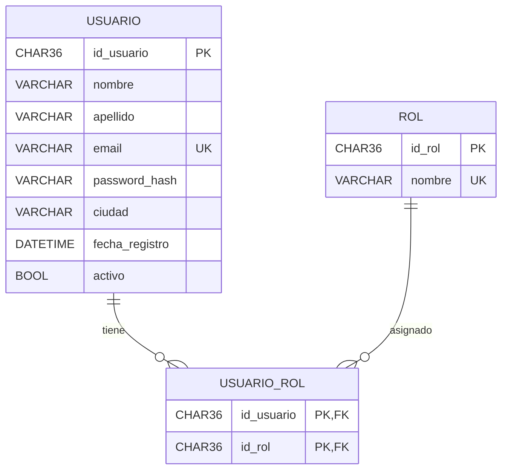
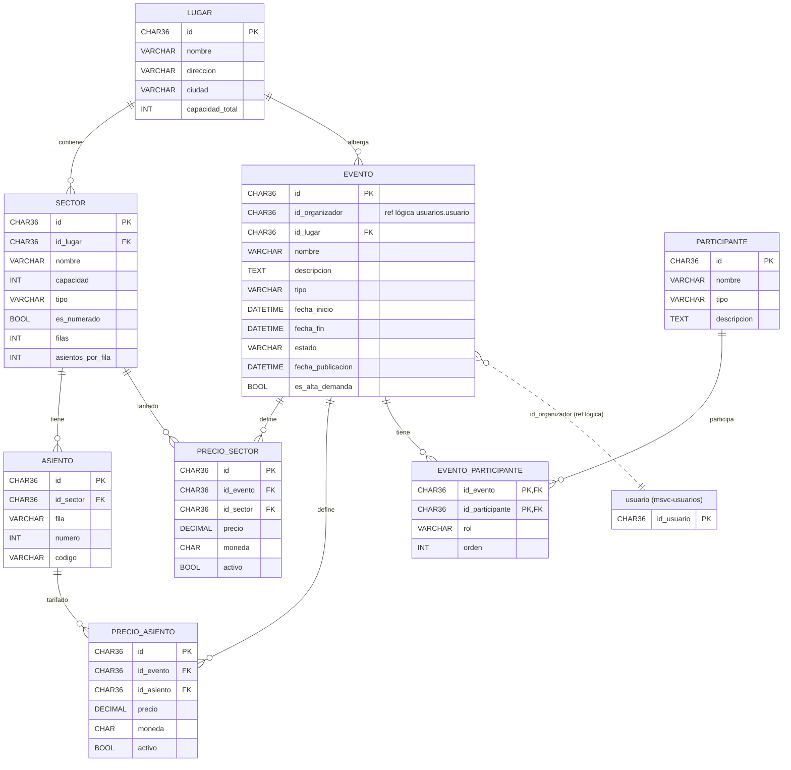
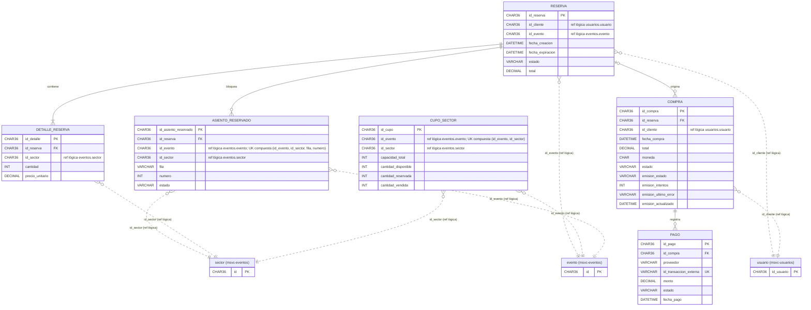
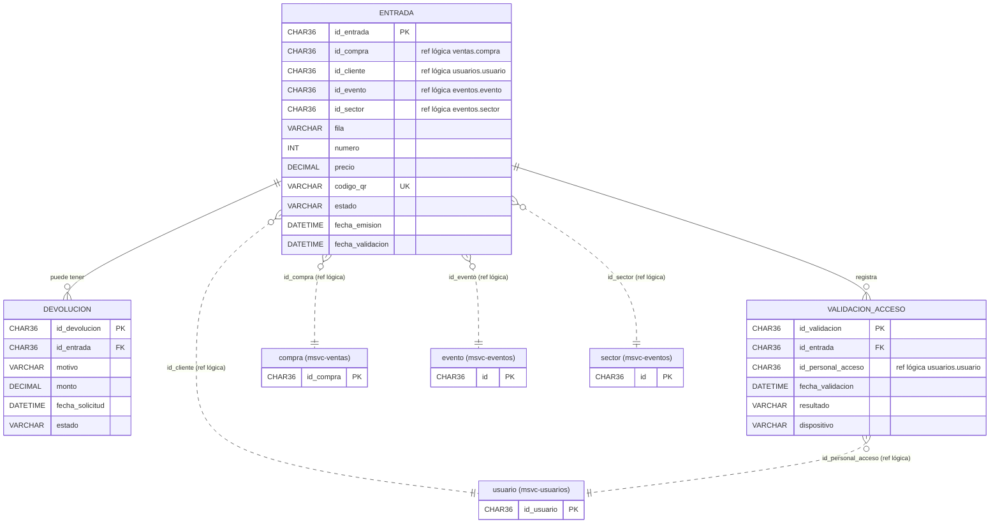
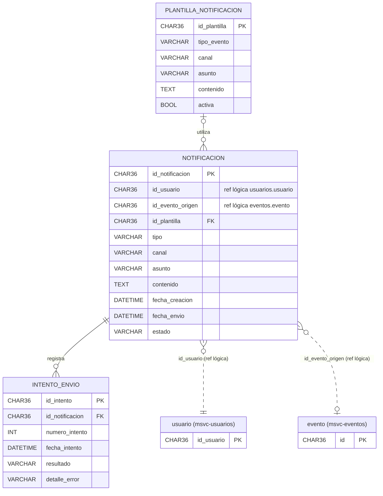

# Modelo entidad-relación por microservicio

## msvc-usuarios

## msvc-eventos

## msvc-ventas

## msvc-entradas

## msvc-notificaciones

## msvc-preferencias (MongoDB)

Ver [`modelo-mongodb.md`](./modelo-mongodb.md).
